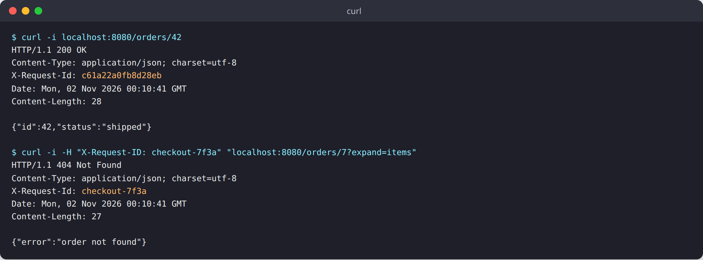
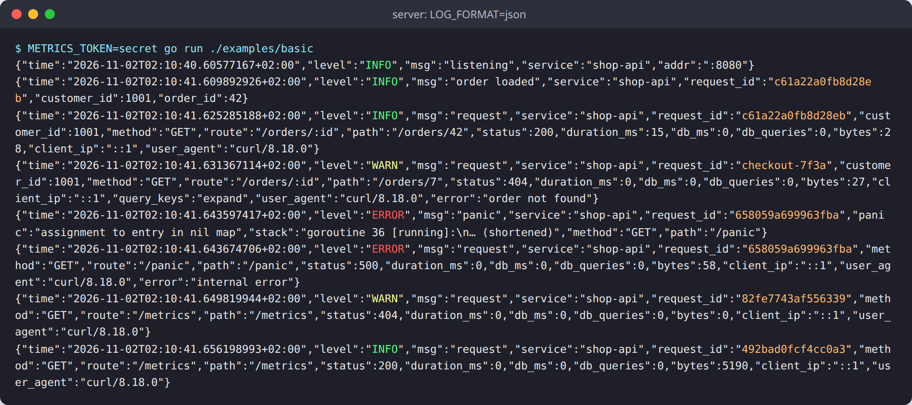
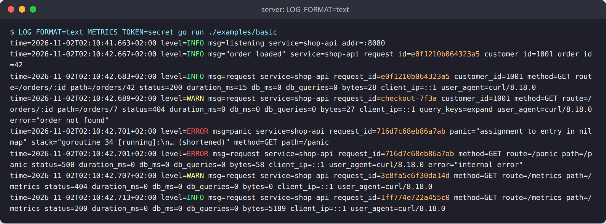
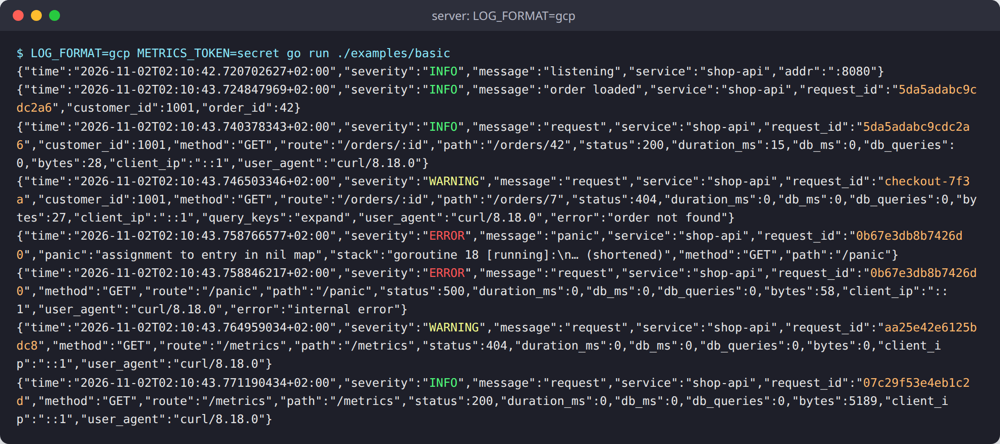
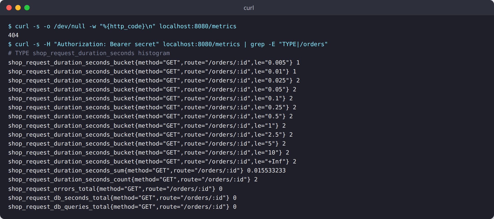

# logx

Request logging and route metrics for Gin and GORM services, built on Go's standard `log/slog`.

[](https://pkg.go.dev/github.com/ez-technologies/logx)
[](LICENSE)

## Why

When something goes wrong in a web service, you want to answer three questions fast:
which request was it, what did it do, and how long did it take. logx gives you that
with very little code:

- **One line per request.** Method, route, path, status, duration, database time, query
  count, response size, client IP and user agent.
- **A request id on every line.** It is sent back in the `X-Request-ID` header. If the
  caller sends a safe id, logx keeps it, so you can follow one operation from the client
  into the server and the database.
- **What happened, not the data.** Request and response bodies are never logged. Query
  parameters are logged by name only. SQL is logged with placeholders, never with bound values.
- **Panics become logged 500s** with a stack trace, instead of a dropped connection.
- **Per-route metrics** in Prometheus text format, behind a bearer token.
- **No new logging API.** It is plain `log/slog`. Pick JSON, text, or Google Cloud
  Logging JSON with an environment variable.

## Install

```sh
go get github.com/ez-technologies/logx@latest
```

## Quick start

```go
package main

import (
	"net/http"
	"os"

	"github.com/ez-technologies/logx"
	"github.com/gin-gonic/gin"
)

func main() {
	logx.Setup(logx.Options{Service: "shop-api"})

	r := gin.New()
	r.Use(logx.Middleware())
	r.GET("/metrics", logx.MetricsHandler(os.Getenv("METRICS_TOKEN")))
	r.GET("/orders/:id", func(c *gin.Context) {
		logx.Annotate(c, "customer_id", 1001)
		logx.From(c.Request.Context()).Info("order loaded")
		c.JSON(http.StatusOK, gin.H{"id": c.Param("id")})
	})
	r.Run(":8080")
}
```

A complete program is in [`examples/basic`](examples/basic/main.go). Run it with:

```sh
METRICS_TOKEN=secret go run ./examples/basic
```

## Screenshots

All screenshots are real output from `examples/basic`. The panic's stack trace is
shortened in the pictures; the real line holds the full stack.

**Requests.** Each response carries an `X-Request-ID`. The second request sends its own id, and logx keeps it.



**JSON logs (the default).** One `request` line per request. `customer_id` was added with `Annotate`,
so it appears on the handler's own line and on the request line. The 404 is logged at `WARN`
with the error text and the query parameter name (`expand`), not its value. The panic is logged at
`ERROR` and the caller gets a 500. The successful `/healthz` probe is not logged.



**Text logs** with `LOG_FORMAT=text`.



**Google Cloud Logging** with `LOG_FORMAT=gcp`: `severity` and `message` instead of `level` and `msg`,
and `WARNING` instead of `WARN`.



**Metrics.** Without the token the endpoint answers 404. With it, you get per-route histograms
and counters, here with the prefix `shop_`.



## How to

### Set the level and format from the environment

`Setup` reads two variables:

| Variable     | Values                                          | Default |
| ------------ | ----------------------------------------------- | ------- |
| `LOG_LEVEL`  | `debug`, `info`, `warn` (or `warning`), `error` | `info`  |
| `LOG_FORMAT` | `json`, `text`, `gcp`                           | `json`  |

Values are not case sensitive. An unknown level means `info`; an unknown format means `json`.

```sh
LOG_LEVEL=debug LOG_FORMAT=text ./server
```

`Setup` also calls `slog.SetDefault`, so plain `slog.Info(...)` calls anywhere in the
program use the same logger. It returns the logger too.

### Pick your own variable names

If your service already uses other names, tell `Setup`:

```go
logx.Setup(logx.Options{
	LevelEnv:  "SHOP_LOG_LEVEL",
	FormatEnv: "SHOP_LOG_FORMAT",
	SQLEnv:    "SHOP_LOG_SQL",
})
```

### Attach fields to a request's log lines

`Annotate` adds key-value pairs to every later line of the current request, including
the final `request` line. Use it for things like the signed-in user or the tenant.

```go
func auth(c *gin.Context) {
	user := currentUser(c)
	logx.Annotate(c, "user_id", user.ID, "role", user.Role)
	c.Next()
}
```

Inside a handler, or in any code that gets the request's context, log with the request's
logger. It carries the request id and the annotations:

```go
logx.From(ctx).Info("payment captured", "amount_cents", 1299)
```

Outside a request, `From` returns the process logger. `logx.RequestID(c)` returns the
id of the current request.

### Log slow SQL with GORM

Use `logx.Gorm` as GORM's logger. It logs only two things:

- a statement slower than `Slow`, at `WARN` (`"slow query"`);
- a statement that failed, at `ERROR` (`"database error"`). A missing row (`gorm.ErrRecordNotFound`) is not an error.

The SQL is logged with placeholders (`$1`, `$2`), never with the values.

```go
db, err := gorm.Open(postgres.Open(dsn), &gorm.Config{
	Logger: logx.Gorm{Slow: 200 * time.Millisecond},
})
```

Pass the request's context to GORM so the lines carry the request id, and so the
request line counts the queries (`db_queries`) and their time (`db_ms`):

```go
db.WithContext(c.Request.Context()).First(&order, c.Param("id"))
```

A `Slow` of zero turns off slow-query lines; errors are still logged.

To see every statement a request ran, set `LOG_SQL=1` (or the variable named by
`SQLEnv`). The request line then has a `sql` field with the statements (placeholders
only, up to 60 per request). This is a diagnostic; leave it off normally.

### Expose metrics with a token

```go
r.GET("/metrics", logx.MetricsHandler(os.Getenv("METRICS_TOKEN")))
```

- With an empty token the endpoint is off and answers 404.
- Otherwise it needs `Authorization: Bearer <token>`. Without it, the answer is also 404.

For every route pattern and method it serves:

| Metric                     | Type      | Meaning                            |
| -------------------------- | --------- | ---------------------------------- |
| `request_duration_seconds` | histogram | Request duration                   |
| `request_errors_total`     | counter   | Responses with status 500 or above |
| `request_db_seconds_total` | counter   | Time spent in database statements  |
| `request_db_queries_total` | counter   | Number of database statements      |

Labels are `method` and `route` (the pattern, such as `/orders/:id`, not the path).
Requests that match no route are not counted. Metrics live in memory and reset when the
process restarts.

Prometheus can scrape it like this:

```yaml
scrape_configs:
  - job_name: shop-api
    authorization:
      credentials: secret
    static_configs:
      - targets: ["localhost:8080"]
```

To add your own lines to the same endpoint, append a writer to `logx.MetricSources`:

```go
logx.MetricSources = append(logx.MetricSources, func(w io.Writer) {
	fmt.Fprintf(w, "shop_open_carts %d\n", openCarts())
})
```

### Use a metric prefix

Set `MetricPrefix` so the names do not clash with other metrics:

```go
logx.Setup(logx.Options{MetricPrefix: "shop_"})
// shop_request_duration_seconds, shop_request_errors_total, ...
```

## Options

All fields are optional.

| Field          | Default        | Meaning |
| -------------- | -------------- | ------- |
| `Service`      | `""`           | Added to every line as `service`. Empty adds nothing. |
| `LevelEnv`     | `"LOG_LEVEL"`  | Name of the variable that holds the level: `debug`, `info`, `warn`, `error`. |
| `FormatEnv`    | `"LOG_FORMAT"` | Name of the variable that holds the format: `json`, `text`, `gcp`. |
| `SQLEnv`       | `"LOG_SQL"`    | Name of the variable that, when `1`, lists each request's SQL statements on its line. |
| `MetricPrefix` | `""`           | Put before every metric name. |
| `Output`       | `os.Stdout`    | Where log lines are written. |

## What the request line contains

| Field         | Meaning |
| ------------- | ------- |
| `request_id`  | The request's id, also in the `X-Request-ID` response header. |
| `method`      | HTTP method. |
| `route`       | The route pattern, such as `/orders/:id`. Empty when no route matched. |
| `path`        | The actual path, such as `/orders/42`. |
| `status`      | Response status. |
| `duration_ms` | Total time of the request. |
| `db_ms`       | Time spent in database statements (with `logx.Gorm`). |
| `db_queries`  | Number of database statements (with `logx.Gorm`). |
| `bytes`       | Response size. |
| `client_ip`   | Client IP, as Gin sees it. |
| `query_keys`  | Names of the query parameters, never their values. Only when there are some. |
| `user_agent`  | First 120 characters of the user agent. Only when there is one. |
| `error`       | For status 400 and above: the `error` field of a JSON error answer (first 300 characters). |
| `sql`         | Only with `LOG_SQL=1`: the statements, with placeholders. |

The level follows the status: `INFO` below 400, `WARN` for 4xx, `ERROR` for 5xx.
A successful request to `/healthz` is not logged, so health probes do not flood the log.

A caller-supplied `X-Request-ID` is kept only when it is 1 to 64 characters of letters,
digits, `-` and `_`. Anything else is replaced with a new random id, so a caller cannot
inject text into your logs.

## Running the tests

```sh
go test ./...
go vet ./...
```

The tests need no database or network.

## Licence

MIT. See [LICENSE](LICENSE).
